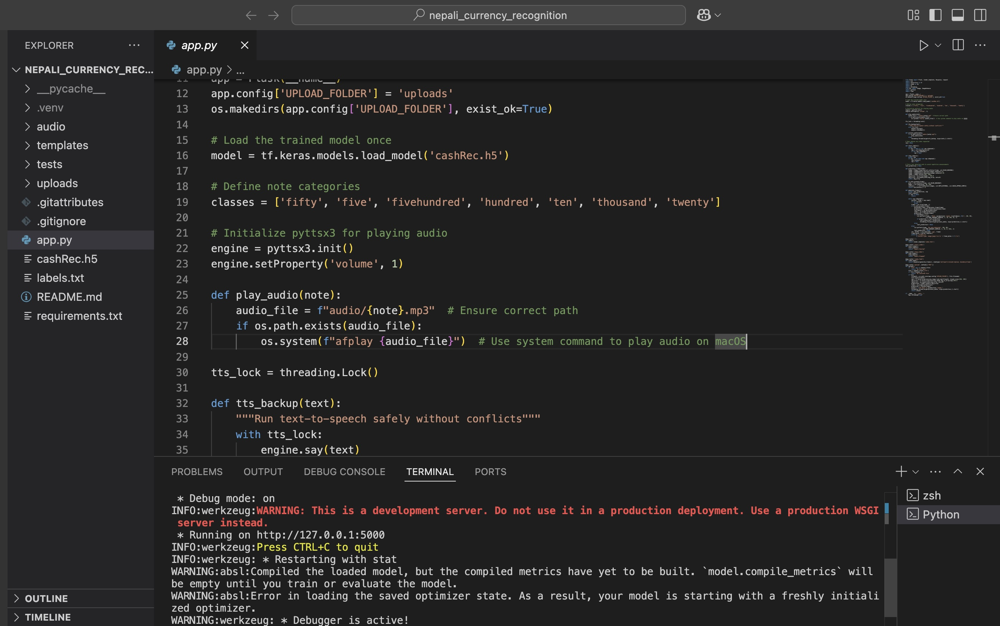

NEPALI CURRENCY DENOMINATION RECOGNITION USING DEEP LEARNING

Project Overview

This project was undertaken as part of my MSc Data Analytics dissertation. It focuses on the application of deep learning and computer vision techniques for the automatic detection and classification of Nepali currency denominations.

The system uses a trained convolutional neural network to classify images of Nepali banknotes into seven denomination categories. In addition to model development and evaluation, a Flask-based web application was implemented to demonstrate the practical use of the trained model.

The application supports both image-based and webcam-based recognition. It also incorporates audio announcements to communicate the predicted denomination, with the aim of improving accessibility for visually impaired users.

Recognized Denominations

The model identifies the following seven Nepali currency denominations:

- NPR 5
- NPR 10
- NPR 20
- NPR 50
- NPR 100
- NPR 500
- NPR 1000

Application Features

- Classification of seven Nepali banknote denominations.
- Image upload and denomination prediction.
- Webcam-based currency recognition.
- Image preprocessing before model prediction.
- Audio announcements of recognized denominations.
- Flask-based web interface for interacting with the model.

Methodology

The project explores deep learning-based image classification using convolutional neural networks. MobileNetV2 was investigated as a transfer learning architecture, alongside a baseline CNN, to examine their performance in recognizing Nepali currency denominations.

The development process involved dataset preparation, image preprocessing, model training, performance evaluation and implementation of the trained model in a web-based application.

Research Results

Dataset

The experiments were conducted using a dataset of 16,249 Nepali currency images representing seven denominations: NPR 5, NPR 10, NPR 20, NPR 50, NPR 100, NPR 500 and NPR 1,000.

The dataset was divided into three subsets:

| Dataset | Number of Images |
|:--------|-----------------:|
| Training | 10,500 |
| Validation | 3,500 |
| Testing | 2,249 |
| **Total** | **16,249** |

Model Performance Comparison

Three model configurations were evaluated: a baseline Convolutional Neural Network (CNN), MobileNetV2 using transfer learning, and MobileNetV2 with hyperparameter tuning.

| Model | Validation Accuracy | Test Accuracy | Precision | Recall | F1-score |
|:------|--------------------:|--------------:|----------:|-------:|---------:|
| Baseline CNN | 87% | 85% | 0.83 | 0.81 | 0.82 |
| MobileNetV2 (Transfer Learning) | 91% | 89% | 0.89 | 0.87 | 0.88 |
| MobileNetV2 (Hyperparameter Tuning) | 95% | 84% | 0.93 | 0.91 | 0.92 |

Key Findings

- MobileNetV2 with transfer learning achieved the highest independent test accuracy of 89%, outperforming the baseline CNN, which achieved    85%.
- Hyperparameter-tuned MobileNetV2 achieved the highest validation accuracy of 95%, along with the strongest reported precision, recall and   F1-score.
- Despite its higher validation accuracy, the tuned model achieved 84% test accuracy, indicating that its validation performance did not    translate into the highest performance on the independent test dataset.
- Classification errors were more frequent between visually similar denominations, particularly NPR 50 and NPR 100.
- Image quality, including lighting conditions, blur and banknote wear, remains an important consideration for reliable recognition.

These results demonstrate the potential of transfer learning and CNN-based approaches for Nepali currency denomination classification, while highlighting the importance of independent testing and further evaluation under diverse real-world conditions.

Technologies and Tools

- Python
- TensorFlow and Keras
- Convolutional Neural Networks
- MobileNetV2
- OpenCV
- NumPy
- Pillow
- Flask

Application Implementation

The developed Flask application provides two methods of currency recognition.

Image Upload

Users can upload an image of a Nepali banknote through the web interface. The application preprocesses the image and passes it to the trained model for denomination classification. The predicted denomination is displayed and communicated through an audio announcement.

Webcam Recognition

The application also supports webcam-based recognition. It captures video frames, processes the images and uses the trained model to identify the denomination. Once a banknote is recognised with sufficient confidence, the application displays and announces the prediction.

Research Background

This work was completed as part of my MSc Data Analytics dissertation at Islington College, in collaboration with London Metropolitan University.

Dissertation Title

Deep Learning Based Detection and Classification of Nepali Currency Denominations Using Optimized Convolutional Neural Networks.

## Application Demonstration

The following demonstrations showcase the web application, real-time currency recognition, image-based classification and audio feedback.

### 1. Application Setup and Web Interface

The application is developed using Flask and provides a web-based interface for interacting with the trained currency recognition model. It can be launched locally through VS Code and accessed through a web browser. After executing `app.py` in VS Code, the Flask development server starts locally and displays the application URL (`http://127.0.0.1:5000`) in the terminal. Opening this URL in a web browser provides access to the Nepali Currency Recognition web application.

**Application Running in VS Code**

**Main Web Application Interface**

### 2. Real-Time Currency Recognition

The application supports real-time currency recognition through a webcam. After selecting the live video option, the webcam is activated, allowing users to position a banknote within the designated detection area. The system predicts the denomination and displays the corresponding confidence score.

The demonstration shows successful recognition of NPR 50, NPR 10 and NPR 20 banknotes.

[Watch Real-Time Currency Recognition Demonstration](videos/real_time_recognition.mp4)

### 3. Recognition of Seven Nepali Currency Denominations

The system is designed to recognise seven Nepali currency denominations: NPR 5, NPR 10, NPR 20, NPR 50, NPR 100, NPR 500 and NPR 1,000.

The following demonstration presents sample images of all seven denominations.

[Watch Seven Denominations Demonstration](videos/available_seven_denominations.mp4)

### 4. Image Upload and Audio-Based Recognition

In addition to webcam-based recognition, the application allows users to upload banknote images for denomination classification. Following image processing and prediction, the application provides an audio announcement of the recognised denomination in Nepali.

This feature demonstrates the potential of the system as an assistive application for visually impaired users by providing auditory feedback alongside visual predictions.

The demonstration includes two examples:

- NPR 5 banknote with a Nepali audio announcement.
- NPR 100 banknote with a Nepali audio announcement.

[Watch Image Upload and Audio Recognition Demonstration](videos/image_upload_testing.mp4)
